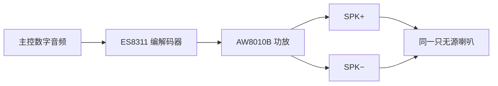

# Air8201G 官方硬件图纸与音频接线排查

核对日期：2026-10-17。此页整理官方资料入口和可复用排查方法，不代表实机发声验收通过。
子型号与外设差异见 [Air8201G-BLMQ 产品记录](../../catalog/vendors/openluat/products/air8201g-blmq.yaml)。

## 2026-11-04 链接复核

经代理 HTTP GET 核对，硬件专页、使用指南及测试软件页面均返回对应 Air8201G 标题；图纸和模型位于 `hardware/8201G/image/`。附件已核对 JPEG、PNG、PDF 文件头及 STEP 的 `ISO-10303-21` 标记，避免将错误页误认为文件。三份历史图纸的字节数与 SHA-256 均与下表一致，保留 2026-10-17 核对日期及原指纹证据。
[Air8201 系列产品介绍](https://docs.openluat.com/air8201/product/8201_knwowhat/)是系列入口；[Air8201G/H 对比](https://docs.openluat.com/air8201/product/8201_compare/)为独立对比表，旧对比地址返回 404。此次链接更新不改变产品能力或实机验收结论。

## 官方图纸索引

| 资料 | 官方入口 | 使用范围 |
| --- | --- | --- |
| G 系列硬件专页 | [Air8201G 硬件资料](https://docs.openluat.com/air8201/hardware/8201G/) | 先核对型号后缀、硬件版本及更新说明 |
| 核心板焊盘示意图 | [8201g_pad.JPEG](https://docs.openluat.com/air8201/hardware/8201G/image/8201g_pad.JPEG) | 区分 SPK、MIC、电源、USB、按键焊盘 |
| 外设控制及 BTB 定义 | [8201G_allpin.png](https://docs.openluat.com/air8201/hardware/8201G/image/8201G_allpin.png) | 核对控制信号和 BTB 24 针表，不把底板接口名称当作已连通证据 |
| V1.5 原理图 | [Air8201G_V1.5.pdf，第 2 页音频](https://docs.openluat.com/air8201/hardware/8201G/image/Air8201G_V1.5.pdf#page=2) | 追踪编解码器、功放及 SPK 输出 |
| V1.5 三维模型 | [3D_Air8201G_v1.5.step](https://docs.openluat.com/air8201/hardware/8201G/image/3D_Air8201G_v1.5.step) | 官方机械参考；不是 PCB 源工程或生产文件 |
| 官方测试软件说明 | [Air8201G 测试软件说明](https://docs.openluat.com/air8201/hardware/8201G/8201G_software/) | 出厂测试软件入口 |
| 官方应用使用指南 | [Air8201G 使用指南](https://docs.openluat.com/air8201/hardware/8201G/8201G_guide/) | 软件、下载与调试入口 |

当日硬件总页列出了上述图纸及模型，未列出 PCB 源工程下载入口；这不代表厂商没有其他提供渠道。
核心板修订与调试底板修订分别核对，不能由底板版本推定核心板为 V1.5。
第三方图纸保留官方链接，不在本仓库镜像分发；链接不是转载许可。

## SPK 与 MIC 的识别

按官方焊盘图展示方向：金属屏蔽罩朝向观察者，4G/GPS 天线座在上方，
SPK 是核心板右侧上部的两块大焊盘；MIC 是同侧更下方的一对较小焊盘。
该位置描述只用于阅读官方图，实际接线仍须对照实物丝印和对应修订图纸。

官方 BTB 24 针表没有列出 SPK。不能据此认定调试底板任意标有音频名称的接口
已连接核心板功放输出；需要对应底板原理图或断电后的连通性检查。

以下为根据 V1.5 原理图概括的信号流，**不是 PCB 布局或焊盘正负位置图**：

## 可复用工程经验：无声时的排查顺序

1. 断电后先确认接的是 SPK 两端，排除 MIC、GND 或未连接的底板接口。
2. SPK 为差分/桥接输出，SPK−不是 GND，不要将任一端直接接地。
3. 单只普通两线无源喇叭交换两根线通常只改变相位，不能解释完全无声。
   多喇叭系统仍需保持相位一致。负载阻抗和功率需按对应硬件资料确认。
4. 核对对应固件的音频 API、编解码器供电、功放使能、静音和音量寄存器读回。
   API 音量数值不能直接当作声压百分比，不能跨不同固件版本推定寄存器行为。
5. 从低幅度、短时测试音开始，同时记录播放事件及后续心跳；播放完成回调不等于喇叭已发声。
   LuatOS 旧音频框架可在 DONE 后读取 `audio.getError(id)`，区分完成事件与文件/解码结果，
   底层成功仍不能证明 I²S 波形、模拟输出或实际发声。没有听到声音时继续检查连接、输出和负载，
   不靠反复增大音量代替诊断。

在确认负载规格并有人配合听验后，可用有界的较长测试音改善观察窗口，逐级调整数字幅度，
保留每段底层结果、内存及供电读数，并在结束或失败时自动关闭功放。
数字幅度倍数、编解码器档位与实际声压是不同量；测试音通过也不等于语音/音乐质量验收。

测量通断时先断开全部电源，并至少将喇叭一端与功放分离，再测喇叭及导线的直流电阻；
不要带电使用电阻档。标称阻抗与直流电阻不同，不能要求读数恰好等于标称 Ω 数。
主控内部 VBAT 读数只作系统供电参考，不替代功放焊盘或瞬态压降测量。

上述经验不提高产品验证等级，也不证明某块实机的接口连通、供电或发声结果。

## 核对文件指纹

用于以后识别厂商是否更新同名文件；指纹不构成转载许可。

| 官方文件 | 当次字节数 | SHA-256 |
| --- | ---: | --- |
| 8201g_pad.JPEG | 407891 | `72e269dabbcf77946cfd7c4ef66810d103ff80fe09b2e2a7a0506d056d577a11` |
| 8201G_allpin.png | 115730 | `8d4b73cc4e90ecebabc31de0bb11a35a7bb02dd729359352781831b130238307` |
| Air8201G_V1.5.pdf | 163655 | `cac4ad674ed13dc2498ddaf4b18ebacd4cc640df629623344c371917464a3e0b` |
